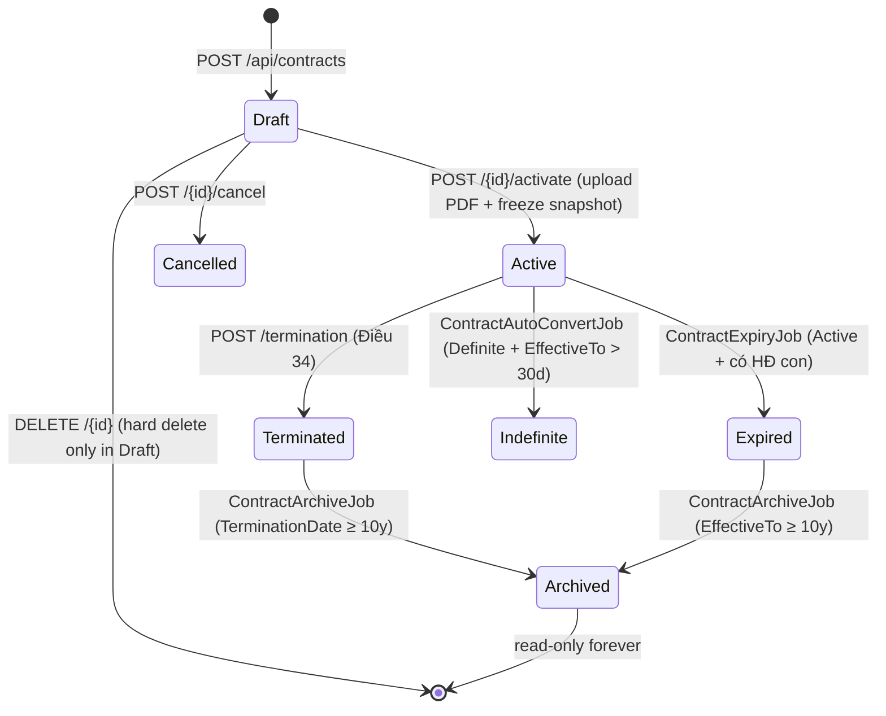
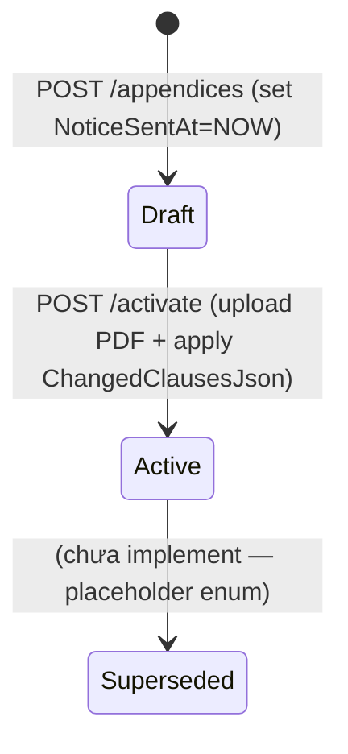
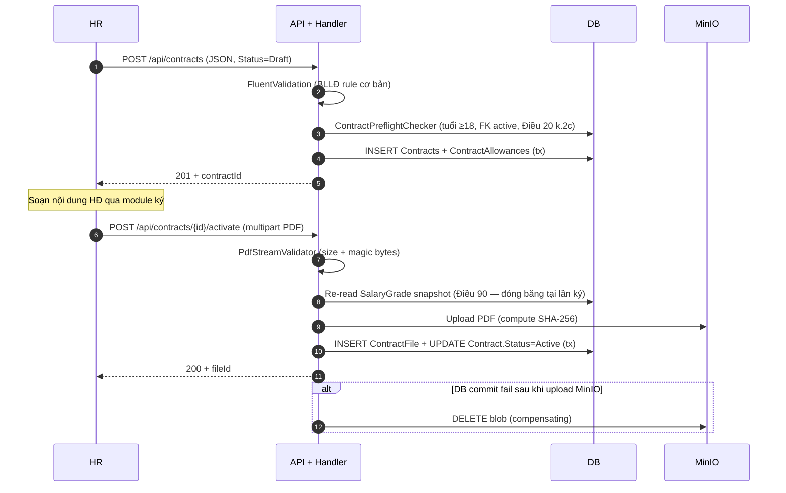
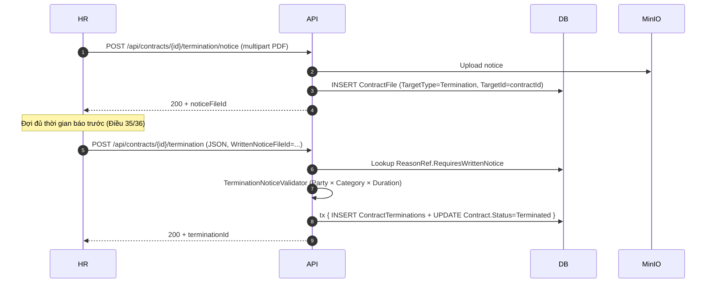

# Contract Management Module

Module quản lý Hợp đồng Lao động (HĐLĐ) theo Bộ luật Lao động 2019 (BLLĐ 2019). Bao gồm CRUD HĐ, phụ lục, chấm dứt, file PDF đã ký lưu trên MinIO, và 3 background job tự động hoá các luật theo thời gian.

> **Phạm vi:** chỉ hỗ trợ NLĐ ≥ 18 tuổi. NLĐ chưa thành niên & giấy uỷ quyền ký HĐ thuộc ngoài scope (xem [CONTRACT_DB_PLAN.md](../../CONTRACT_DB_PLAN.md) §7 Q10).

---

## 1. Ranh giới với các module khác

| Việc | Module này | Module khác |
|---|---|---|
| Soạn HĐ (text) | ✅ `ContractText` lưu trong DB | – |
| Render PDF từ template | ❌ | Module ký số |
| Ký số / chữ ký điện tử | ❌ | Module ký số |
| Verify chữ ký số trong PDF | ❌ | Module ký số |
| Verify SHA-256 của blob | ✅ | – |
| Tính lương từ HĐ | ❌ | Module payroll |
| Webhook nhận callback từ module ký | ❌ — HR upload PDF thủ công | Module ký số |

---

## 2. Database schema (10 bảng)

| Bảng | Mục đích | Ràng buộc chính |
|---|---|---|
| `Contracts` | HĐLĐ chính (thử việc + chính thức) | unique `ContractNo`, index `(EmployeeId, Status)`, index `ArchivedAt` |
| `ContractParties` | Pháp nhân NSDLĐ (append-only versioning) | tại 1 thời điểm chỉ có 1 row `EffectiveTo IS NULL` |
| `ContractAppendices` | Phụ lục HĐ (Điều 22, 33) | FK → Contracts; `(ContractId, AppendixNo)` unique |
| `ContractTerminations` | Chấm dứt HĐ (Điều 34) | **1-1** với Contracts (unique `ContractId`) |
| `ContractFiles` | PDF đã ký (polymorphic via `TargetType`+`TargetId`) | index `(TargetType, TargetId, IsCurrent)` |
| `ContractTemplates` | Mẫu HĐ (Versioning + placeholder validation) | tổ hợp `(Indefinite, Probation)` invalid |
| `ContractTerminationReasonRefs` | Seed lookup 13 lý do Điều 34 (k.1-13) | unique `Code` |
| `SalaryGrades` | Thang lương cho HĐ | unique `Code` |
| `AllowanceTypes` | Loại phụ cấp | unique `Code` |
| `ContractAllowances` | Junction Contract ↔ AllowanceType | unique `(ContractId, AllowanceTypeId)` |

Migration: `20260604024058_AddContractSeedsAndArchivedIndex` (cộng dồn từ initial schema migration).

---

## 3. Permission matrix

32 permissions (IDs 33–64). Map sang 7 system roles:

| Permission | SystemAdmin | HR | Accountant | Director | DeptMgr | Employee | Auditor |
|---|---|---|---|---|---|---|---|
| `Contract.Read.All` | ✅ | ✅ | ✅ | – | – | – | ✅ |
| `Contract.Read.Self` | – | – | – | – | – | ✅ | – |
| `Contract.Create.All` | ✅ | ✅ | – | – | – | – | – |
| `Contract.Update.All` (Draft only) | ✅ | ✅ | – | – | – | – | – |
| `Contract.Delete.All` (Draft hard) | ✅ | ✅ | – | – | – | – | – |
| `Contract.Activate.All` | ✅ | ✅ | – | – | – | – | – |
| `Contract.Cancel.All` (Draft → Cancelled) | ✅ | ✅ | – | – | – | – | – |
| `ContractAppendix.Read.All` | ✅ | ✅ | ✅ | – | – | – | ✅ |
| `ContractAppendix.Read.Self` | – | – | – | – | – | ✅ | – |
| `ContractAppendix.Create.All` | ✅ | ✅ | – | – | – | – | – |
| `ContractAppendix.Activate.All` | ✅ | ✅ | – | – | – | – | – |
| `ContractTermination.Read.All` | ✅ | ✅ | ✅ | – | – | – | ✅ |
| `ContractTermination.Read.Self` | – | – | – | – | – | ✅ | – |
| `ContractTermination.Create.All` | ✅ | ✅ | – | – | – | – | – |
| `ContractFile.Read.All` | ✅ | ✅ | ✅ | – | – | – | ✅ |
| `ContractFile.Read.Self` | – | – | – | – | – | ✅ | – |
| `ContractFile.Upload.All` | ✅ | ✅ | – | – | – | – | – |
| `ContractFile.Delete.All` | ✅ | – | – | – | – | – | – |
| `SalaryGrade.*` (4 perms) | ✅ | ✅ | – | – | – | – | – |
| `AllowanceType.*` (4 perms) | ✅ | ✅ | – | – | – | – | – |
| `ContractTemplate.*` (4 perms) | ✅ | ✅ | – | – | – | – | – |
| `ContractParty.*` (2 perms) | ✅ | – | – | – | – | – | – |

> **Self-scope** (`.Self`): list endpoint **silently filter** về data của caller (không trả 403). Detail endpoint khác `EmployeeId` → throw `ForbiddenAccessException` (HTTP 401 theo middleware mapping).

---

## 4. Endpoint catalogue

### 4.1. Catalog (Phase 3)

| Method | Route | Permission |
|---|---|---|
| GET | `/api/salary-grades?positionId=&isActive=` | `SalaryGrade.Read.All` |
| GET/POST/PUT/DELETE | `/api/salary-grades[/{id}]` | `SalaryGrade.*` |
| GET/POST/PUT/DELETE | `/api/allowance-types[/{id}]` | `AllowanceType.*` |
| GET/POST/PUT/DELETE | `/api/contract-templates[/{id}]` | `ContractTemplate.*` |
| GET/POST | `/api/contract-parties` | `ContractParty.*` (append-only, no PUT/DELETE) |

### 4.2. Contract core (Phase 5–6)

| Method | Route | Permission | Trạng thái HĐ cho phép |
|---|---|---|---|
| POST | `/api/contracts` | `Contract.Create.All` | – (tạo Draft) |
| GET | `/api/contracts?employeeId=&status=&category=&page=&size=` | `Read.All`/`Read.Self` | – |
| GET | `/api/contracts/{id}` | `Read.All`/`Read.Self` | – |
| PUT | `/api/contracts/{id}` | `Update.All` | Draft |
| DELETE | `/api/contracts/{id}` | `Delete.All` | Draft (hard delete) |
| POST | `/api/contracts/{id}/cancel` | `Cancel.All` | Draft → Cancelled |
| POST | `/api/contracts/{id}/allowances` | `Update.All` | Draft |
| PUT | `/api/contracts/{id}/allowances/{allowanceTypeId}` | `Update.All` | Draft |
| DELETE | `/api/contracts/{id}/allowances/{allowanceTypeId}` | `Update.All` | Draft |
| POST | `/api/contracts/{id}/activate` (multipart PDF) | `Activate.All` | Draft → Active |
| POST | `/api/contracts/{id}/files/replace` (multipart PDF) | `Activate.All` | Active (giữ history) |

### 4.3. Appendix (Phase 7)

| Method | Route | Permission |
|---|---|---|
| POST | `/api/contracts/{contractId}/appendices` | `ContractAppendix.Create.All` |
| GET | `/api/contracts/{contractId}/appendices` | `Read.All`/`Read.Self` |
| GET | `/api/contract-appendices/{id}` | `Read.All`/`Read.Self` |
| POST | `/api/contract-appendices/{id}/activate` (multipart PDF) | `Activate.All` |

### 4.4. Termination (Phase 8)

| Method | Route | Permission |
|---|---|---|
| POST | `/api/contracts/{contractId}/termination/notice` (multipart PDF) | `ContractFile.Upload.All` |
| POST | `/api/contracts/{contractId}/termination` (JSON) | `ContractTermination.Create.All` |
| GET | `/api/contracts/{contractId}/termination` | `Read.All`/`Read.Self` |

### 4.5. Admin background-job triggers (Phase 9)

| Method | Route | Role |
|---|---|---|
| POST | `/api/admin/contracts/jobs/auto-convert/run` | SystemAdmin |
| POST | `/api/admin/contracts/jobs/expire/run` | SystemAdmin |
| POST | `/api/admin/contracts/jobs/archive/run` | SystemAdmin |

---

## 5. State machines

### 5.1. Contract.Status



> `Cancelled` là trạng thái terminal cho HĐ DRAFT — không thể activate lại; phải tạo HĐ mới.

### 5.2. ContractAppendix.Status



### 5.3. ContractTermination

1-1 với Contract. Không có state — đã tạo là chốt; muốn sửa phải fix bản ghi rồi update Contract.Status thủ công (admin).

---

## 6. Quy trình nghiệp vụ (workflow)

### 6.1. Tạo HĐ mới



### 6.2. Ký phụ lục

```mermaid
sequenceDiagram
    autonumber
    participant HR
    participant API
    participant DB
    participant MinIO

    HR->>API: POST /api/contracts/{id}/appendices (Status=Draft, NoticeSentAt=NOW)
    API->>API: AppendixSchemaValidator (cấm 4 key cấm)
    API->>API: WorkingDayCalculator (Điều 33 — ≥3 working days)
    API->>DB: INSERT ContractAppendices

    Note over HR: Lấy chữ ký 2 bên, ≥3 working days sau NoticeSentAt

    HR->>API: POST /api/contract-appendices/{id}/activate (multipart PDF)
    API->>MinIO: Upload PDF
    API->>DB: tx { INSERT ContractFile (TargetType=Appendix); AppendixApplier mutate Contract + Allowances; UPDATE Appendix.Status=Active }
    API-->>HR: 200 + fileId
```

### 6.3. Chấm dứt HĐ



---

## 7. Background jobs (Phase 9)

| Job | Tần suất | Cutoff | Logic |
|---|---|---|---|
| `ContractAutoConvertJob` | 24h | `EffectiveTo < NOW-30d` | Definite + Active + chưa convert → Indefinite, `EffectiveTo=null`, `ConvertedFromDefiniteFlag=true` |
| `ContractExpiryJob` | 24h | `EffectiveTo < NOW` | Active + có HĐ con (ParentContractId trỏ về) → Expired |
| `ContractArchiveJob` | 24h | `NOW-10y` | (Terminated với TerminationDate ≤ cutoff) ∪ (Expired với EffectiveTo ≤ cutoff) → `ArchivedAt=NOW` |

**Pattern:** `BackgroundService` + `Task.Delay` + `SemaphoreSlim(1,1)` (chống overlap) + scope-per-tick (DbContext + IClock).

**Time abstraction:** `IClock` interface — production dùng `SystemClock` (singleton, trả `DateTime.UtcNow`); test inject fake với UtcNow cố định.

**Manual trigger (test/debug):** 3 admin endpoint `/api/admin/contracts/jobs/*/run` (xem §4.5). Cùng instance hosted service được resolve lại cho controller, nên semaphore vẫn áp dụng — không thể chạy đồng thời với scheduled tick.

---

## 8. Archive guard (Phase 9)

HĐ đã `ArchivedAt != null` là read-only theo Luật Lưu trữ (10 năm sau khi chấm dứt).

**Implementation:** MediatR pipeline behavior `ArchivedContractGuardBehavior<TRequest, TResponse>`:
- Apply cho mọi request implement marker `IContractScopedCommand` (interface có `int ContractId`)
- Behavior chạy **trước** `ValidationBehavior` để fail-fast (tránh waste FluentValidation cost)
- 1 SELECT trên `Contracts.ArchivedAt` → nếu `!= null` throw `ContractArchivedException`
- Middleware map exception → **HTTP 409** với body:
  ```json
  { "code": "CONTRACT_ARCHIVED", "error": "...", "contractId": 42 }
  ```

**Commands có guard (11):** Update, Delete, Cancel, Activate, ReplaceFile, AddAllowance, UpdateAllowance, RemoveAllowance, CreateAppendix, UploadNotice, CreateTermination.

`ActivateContractAppendixCommand` không apply marker (lookup key là `AppendixId`); thay vào đó repository có guard cứng trong transaction.

---

## 9. Configuration

### 9.1. MinIO (Phase 4)

```json
"Minio": {
  "Endpoint": "localhost:9000",
  "UseSsl": false,
  "DefaultBucket": "mps-storage-dev",
  "PresignedUrlMaxExpirySeconds": 900,
  "OperationTimeoutSeconds": 30,
  "EnableBucketBootstrap": true,
  "EnableVersioning": true,
  "RetryCount": 3
}
```

Secret keys → user-secrets dev / env var prod:
```bash
dotnet user-secrets set "Minio:AccessKey" "..." --project src/MPS.API
dotnet user-secrets set "Minio:SecretKey" "..." --project src/MPS.API
```

Health check: `GET /health/minio`.

### 9.2. ContractParty seed (Phase 2)

`DatabaseSeeder` đọc `appsettings.json`:
```json
"ContractParty": {
  "LegalName": "Công ty Mingo",
  "TaxCode": "0100000000",
  "Address": "...",
  "RepresentativeFullName": "...",
  "RepresentativeTitle": "Giám đốc"
}
```

Nếu thiếu → log warning, không seed. Admin sẽ tạo qua POST `/api/contract-parties`.

### 9.3. Rate limit upload (Phase 6+)

Policy `contract-upload` — 5 req/min/user (fallback IP), áp dụng cho:
- `POST /api/contracts/{id}/activate`
- `POST /api/contracts/{id}/files/replace`
- `POST /api/contract-appendices/{id}/activate`
- `POST /api/contracts/{id}/termination/notice`

Vượt → 429.

### 9.4. Request size cap

`[RequestSizeLimit(25 * 1024 * 1024)]` = 25MB hard cap ở Kestrel. `PdfStreamValidator` enforce business limit 20MB. Khoảng cách 5MB để chứa boundary multipart overhead.

---

## 10. Object key convention (MinIO)

| Target | Pattern | Ví dụ |
|---|---|---|
| Contract PDF | `contracts/{yyyy}/{MM}/{contractNo}/v{version}.pdf` | `contracts/2026/06/HDLD-2026-0001/v1.pdf` |
| Appendix PDF | `appendices/{yyyy}/{MM}/{contractNo}/{appendixNo}-v{version}.pdf` | `appendices/2026/06/HDLD-2026-0001/PL-001-v1.pdf` |
| Termination notice | `terminations/{yyyy}/{MM}/{contractNo}/notice-v{version}.pdf` | `terminations/2026/06/HDLD-2026-0001/notice-v1.pdf` |

`ObjectKeyBuilder` validate segment để chặn path traversal (`..`), null bytes, slashes lẫn vào.

---

## 11. Error catalogue (4xx/5xx codes)

| Code | HTTP | Tình huống |
|---|---|---|
| `EMPLOYEE_UNDER_AGE` | 400 | NLĐ < 18 tuổi tại `EffectiveFrom` |
| `FORBIDDEN_APPENDIX_KEY` | 400 | `ChangedClausesJson` chứa key cấm (EffectiveFrom/To/Category/Subtype) |
| `APPENDIX_NOTICE_TOO_SHORT` | 400 | EffectiveFrom < NoticeSentAt + 3 working days (Điều 33) |
| `WRITTEN_NOTICE_REQUIRED` | 400 | ReasonRef.RequiresWrittenNotice=true nhưng WrittenNoticeFileId thiếu (Điều 45) |
| `TERMINATION_NOTICE_INDEFINITE_TOO_SHORT` | 400 | HĐ Indefinite mà NoticeDaysAhead < 45 |
| `TERMINATION_NOTICE_DEFINITE_12_36M_TOO_SHORT` | 400 | HĐ Definite 12-36m mà NoticeDaysAhead < 30 |
| `TERMINATION_NOTICE_DEFINITE_UNDER_12M_TOO_SHORT` | 400 | HĐ Definite < 12m mà working-day gap < 3 |
| `TERMINATION_NOTICE_DEFINITE_MISSING_END` | 400 | Definite mà input thiếu EffectiveTo |
| `CONTRACT_ARCHIVED` | **409** | Mọi write trên HĐ đã `ArchivedAt != null` |
| (FluentValidation errors) | 400 | Body 4xx từ validator |
| (FileStorageUnavailableException) | 503 | MinIO down khi upload |

---

## 12. Troubleshooting

### 12.1. "Tại sao activate trả 503?"
MinIO down hoặc timeout. HĐ vẫn ở Draft, chưa bị mark Active. HR retry sau khi MinIO khả dụng. Logger ghi rõ `ObjectKey` trong warning.

### 12.2. "Tôi update HĐ Active được không?"
Không. Update chỉ chấp nhận `Status=Draft`. HĐ Active → ký phụ lục (POST `/api/contracts/{id}/appendices`) cho phần thay đổi cho phép theo Điều 22.

### 12.3. "Activate trả `only Draft can be activated`?"
HĐ đã ở Active/Expired/Terminated/Cancelled rồi. Activate là transition 1 chiều Draft → Active.

### 12.4. "Tôi gọi `/cancel` trên HĐ Active → 400?"
Cancel chỉ cho Draft. HĐ Active muốn đóng → dùng termination flow (Phase 8).

### 12.5. "Phụ lục đang Draft thì update HĐ được không?"
Không liên quan. HĐ Active vẫn Active, write thẳng vào HĐ vẫn bị chặn (chỉ Draft mới được update). Phụ lục là nhánh song song.

### 12.6. "Termination trả `expected Active`?"
Có thể HĐ đã ở Terminated/Expired/Cancelled. 1 HĐ chỉ terminate được 1 lần (1-1 với `ContractTerminations`).

### 12.7. "Tôi reupload notice → mất file cũ?"
Không. Pattern giống Phase 6: file cũ → `IsCurrent=false` (giữ history), file mới → `Version=N+1, IsCurrent=true`. MinIO object thì có version mới.

### 12.8. "Job background không chạy?"
Check:
1. App đã start ≥ 5 phút (3 job có initial delay 2/3/5 phút khi startup)
2. Log có dòng `ContractAutoConvertJob started; interval=24:00:00` không
3. SemaphoreSlim có thể đang giữ (job chạy lâu hoặc trigger thủ công đồng thời). Log sẽ ghi `already running; skipping this trigger.`

Manual trigger qua admin endpoint nếu cần test:
```bash
curl -X POST -H "Authorization: Bearer $TOKEN" \
  http://localhost:5000/api/admin/contracts/jobs/auto-convert/run
```

---

## 13. Security checklist (Phase 10)

| Kiểm tra | Status | Vị trí |
|---|---|---|
| Mọi upload check content-type + size + magic bytes | ✅ | `PdfStreamValidator` |
| Presigned URL TTL ≤ 15 phút | ✅ | `MinioOptions.PresignedUrlExpiryMinutes=15` |
| Object key chặn path traversal | ✅ | `ObjectKeyBuilder.ValidateSegment` |
| Self-scope filter cho list endpoint | ✅ | Handler-level check `_currentUserService.HasPermission(*.Read.Self)` |
| Rate limit upload | ✅ | Policy `contract-upload` 5/min/user |
| Audit log uploader / creator / decider | ✅ | `UploadedByUserId`, `CreatedByUserId`, `DecidedByUserId` set từ `_currentUserService.UserId` |
| Archive guard không bypass được | ✅ | Behavior chạy trước handler; guard cứng cũng có trong transaction repo |
| Secrets không hardcode | ✅ | MinIO Access/Secret qua user-secrets / env var |
| FK + unique constraint enforce ở DB | ✅ | EF Core configurations + index |

---

## 14. Testing

**Suite hiện tại:** 212 tests (158 Application + 54 Infrastructure), 0 fail.

Phân bố theo feature (Application):

| Feature | Test count |
|---|---|
| Contract (validator + preflight + integration) | 32 |
| ContractAppendix (working day + schema + applier + integration) | 28 |
| ContractTermination (notice validator + integration) | 20 |
| BackgroundJobs + Behaviors | 12 |
| SalaryGrade | 9 |
| AllowanceType | 9 |
| (others — Auth/User/EmployeeInformation/Role/PerformanceMetric) | 48 |

Chạy:
```bash
dotnet test MPS.sln
```

Chạy với coverage:
```bash
dotnet test MPS.sln /p:CollectCoverage=true /p:CoverletOutputFormat=cobertura
```

---

## 15. Tham chiếu

- [contract-implementation-plan.md](../plans/contract-implementation-plan.md) — kế hoạch chi tiết Phase 1–10
- [CONTRACT_DB_PLAN.md](../../CONTRACT_DB_PLAN.md) — thiết kế DB (10 bảng, business rule theo điều luật)
- [auth/README.md](../auth/README.md) — hệ thống authz dùng chung
- Bộ luật Lao động 2019: Điều 13, 14, 18, 20, 22, 24, 25, 26, 33, 34, 35, 36, 45, 90, 156, 177
